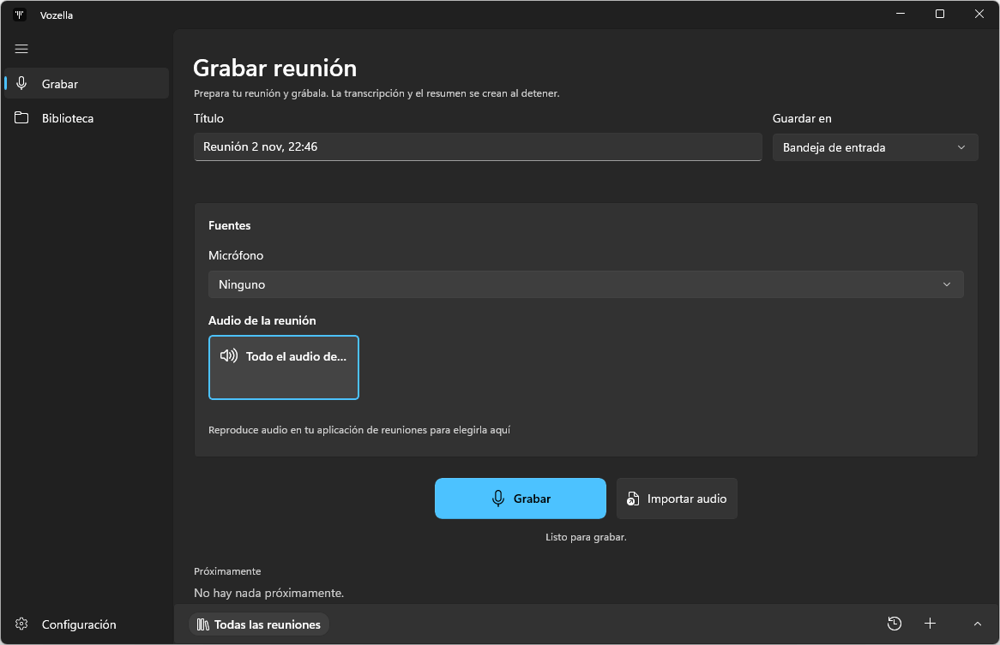

<picture>
  <source media="(prefers-color-scheme: dark)" srcset="docs/brand/vozella-tile-light.svg">
  
</picture>

# Vozella

Every meeting, written down.

**Status:** beta, Windows only, unsigned installer. [Download the latest build](https://github.com/andrest04/vozella/releases/latest/download/Vozella-Setup.exe) or build from source.



## What it does

- **Records without a bot.** Captures your microphone plus all system audio or a single app, and nothing joins the call. You can also import audio.
- **Transcribes.** Shows a live preview while recording, then writes the final transcript from the recording after you stop. Speaker labels are optional, for up to four voices.
- **Writes notes.** Summaries, action items and templates.
- **Helps during the call.** A live copilot window, detected questions and "What did I miss?".
- **Reminds you.** Windows calendar reminders about one minute before meetings with two or more people, and a popup when a Zoom, Teams or Meet call is detected.
- **Keeps a library.** Folders, search, and chat scoped to a meeting, a folder or all meetings.

| Option | Choices |
| --- | --- |
| Summary and chat engine | Local (GGUF on this PC, no account), Claude Code or Codex (your own signed-in CLI), or your own API key (OpenAI, Anthropic, Gemini, or any OpenAI-compatible server) |
| Transcription language | Auto, English, Spanish, Portuguese, French, German, Italian, Dutch, Japanese, Chinese |
| UI and summary language | English, Spanish |

## State

The app lives in `apps/desktop`, `packages/*` and `native/*`. Automated tests pass. It is not yet validated with real meetings, real accounts or the installer. The verified and pending items are in [`odd/tasks/electron-port.md`](odd/tasks/electron-port.md), under "Final state".

It began as a port of an earlier WinUI 3 app named MeetingLive, which is no longer in this repo.

## Where your data goes

| Data | Where it goes |
| --- | --- |
| Transcription | Runs on this PC. The speech model and a small runtime download once during setup. |
| Summaries and chat | Go to the engine you choose. Local stays on this PC; Claude Code, Codex and API key engines send the text to the provider you set up. An OpenAI-compatible server running on this PC keeps it local. With Claude Code or Codex, live answers can also search the web. |
| TypeSafe (optional) | Sends the transcript to TypeSafe. Off until you save a key. |
| Meetings and recordings | Markdown files with their recordings in `Documents\Vozella`. It follows OneDrive redirection, so a redirected Documents folder puts them in OneDrive too. |

The earlier MeetingLive app used `Documents\MeetingLive`; Vozella detects that folder but does not share it by default.

## Build and run

Prerequisites:

- Windows on x64
- Node.js 24 or later
- pnpm 12 (`packageManager` pins the version)
- Rust with `cargo` on PATH, and the Visual C++ build tools, for the native addon

```powershell
# Install dependencies
pnpm install

# Run the app in development
pnpm dev

# Typecheck, lint and run the unit tests
pnpm check

# Run the end-to-end tests
pnpm test:e2e

# Build the installer
pnpm package
```

`pnpm package` writes an unsigned NSIS installer to `apps/desktop/release/`.

Every push to `main` that touches the app builds the installer on GitHub Actions and publishes it as the latest release, which is what the landing page links to.

## Project layout

| Folder | Contents |
| --- | --- |
| `apps/desktop/` | Electron app: main process, preload, React renderer, workers |
| `packages/contracts/` | Typed IPC schemas and channels |
| `packages/core/` | Pure domain logic by feature, with ports as interfaces |
| `packages/platform/` | Node adapters for the ports, plus fakes |
| `native/vozella-native/` | Rust addon: audio, calendar, DPAPI, sessions, windows |
| `website/` | Landing page |
| `docs/port/` | Electron port: stack, specs, parity ledgers, research, screenshots |
| `docs/brand/` | Logo files |
| `docs/screenshots/` | README screenshots |
| `scripts/` | Icon generation |
| `odd/tasks/` | Feature task notes |
| `.agents/`, `.claude/` | Coding agent skills and settings |

The Electron stack and its conventions are in [`docs/port/stack.md`](docs/port/stack.md). Agent and contributor guidance is in [AGENTS.md](AGENTS.md).

## Naming

The product is Vozella and the app uses that name throughout. A few `MeetingLive` names remain on purpose: the legacy data folder Vozella detects, and the internal `https://meetinglive.local/meeting/` link scheme stored in chats and notes.

## License

No license has been chosen yet, so all rights are reserved for now.
